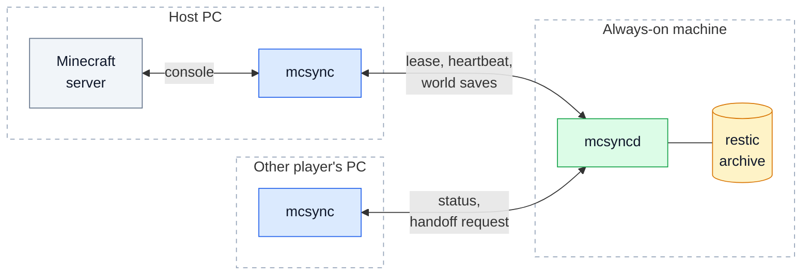

<h1 align="center">mcsync</h1>

<p align="center">
  Shared Minecraft Java worlds for small groups of friends, without a 24/7 game server.
</p>

<p align="center">
  <a href="https://github.com/FedericoArdesi/mcsync/actions/workflows/test.yml"></a>
  <a href="LICENSE"></a>
  
  
</p>

Whoever wants to play becomes the host and runs the server on their own PC. A small always-on machine, such as a spare laptop or mini-PC, stores the world and its version history and keeps track of who the current host is. There are no hosting costs and no diverging copies of the world.

> **Alpha.** The core is feature-complete and covered by an extensive test suite, but it has so far been exercised mainly with a simulated game server. Do not use it as the only copy of a world you care about. See [Limitations](docs/limitations.md).

*mcsync is not affiliated with Mojang, Microsoft or Minecraft. It does not include or distribute any Minecraft software; you provide your own `server.jar`.*

## Features

- **One host at a time.** A lease held on the always-on machine guarantees that the world never forks.
- **Versioned, deduplicated storage** backed by [restic](https://restic.net). Every save is a new version; nothing is overwritten.
- **Automatic saves** every 10 minutes while playing, plus a final save on shutdown.
- **Host handoff.** A player can ask the current host to save and pass the lease on, with no manual coordination.
- **Fail-safe.** If the always-on machine becomes unreachable, the host's server stops cleanly before the lease expires. Uploads that cannot be committed are kept for recovery, never discarded.
- **Private by design.** No open ports on your router, per-device revocable tokens, built to run over a private network such as [Tailscale](https://tailscale.com).
- **No external dependencies.** Written in Go, one binary per role.

## How it works

mcsync has two programs. **`mcsyncd`** runs on the always-on machine and owns the lease, the version history and the archive. **`mcsync`** runs on each player's PC, controls the Minecraft server and keeps the world in sync.



For the protocol in detail (lease, commits, sessions, handoff, failure behaviour), see [Architecture](docs/architecture.md).

## Requirements

- **Always-on machine:** Linux (developed on Ubuntu Server), [restic](https://restic.net) in `PATH`, and an address on a private network.
- **Player PCs:** Windows or Linux. Real play needs Java and a Minecraft `server.jar`. Without `--server-jar`, `mcsync` runs a simulated game, which is useful for trying out the whole workflow.
- **Go 1.22 or later** to build from source.

## Installation

```sh
git clone https://github.com/FedericoArdesi/mcsync.git
cd mcsync
go build ./cmd/mcsync ./cmd/mcsyncd
```

Copy `mcsyncd` to the always-on machine and `mcsync` to each player's PC.

## Quick start

**1. Set up the always-on machine**

```sh
mcsyncd init   --data /srv/mcsync
mcsyncd serve  --data /srv/mcsync --listen 100.x.y.z:8765
mcsyncd invite --data /srv/mcsync --addr 100.x.y.z:8765 player1
```

`100.x.y.z:8765` is the machine's address on your private network. `init` generates the archive encryption key; **back it up outside the machine**, because without it saved worlds cannot be read. The invite code is single-use and expires after 24 hours.

**2. Enroll each player's PC**

```sh
mcsync enroll <invite-code> --label "Player 1 PC"
```

**3. Play**

```sh
mcsync run --world /path/to/world --server-jar /path/to/server.jar --jvm-args "-Xmx4G"
```

`Ctrl+C` stops the server, saves the world and releases the lease. If another player is currently hosting, use `mcsync handoff` with the same options to ask them to pass the lease on.

A step-by-step setup, including running `mcsyncd` as a service, is in [Deployment](docs/deployment.md).

## Documentation

| Document | Contents |
| --- | --- |
| [Architecture](docs/architecture.md) | Components, lease and version rules, session lifecycle, host handoff, failure behaviour |
| [Deployment](docs/deployment.md) | Setting up the always-on machine and player PCs, running as a service, data layout |
| [Command reference](docs/commands.md) | All commands and options for `mcsyncd` and `mcsync` |
| [Security](docs/security.md) | Network exposure, tokens, invites, encryption |
| [Limitations and roadmap](docs/limitations.md) | Known limitations and planned features |
| [Development](docs/development.md) | Code layout, running the tests, the simulated game |

## License

Released under the [MIT License](LICENSE).
