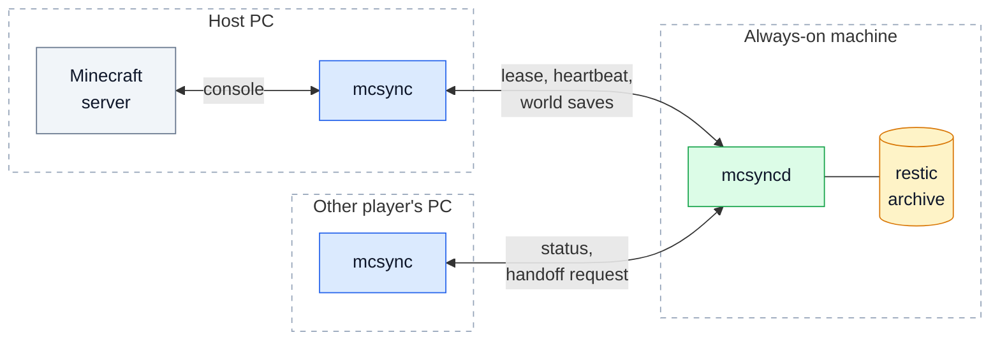
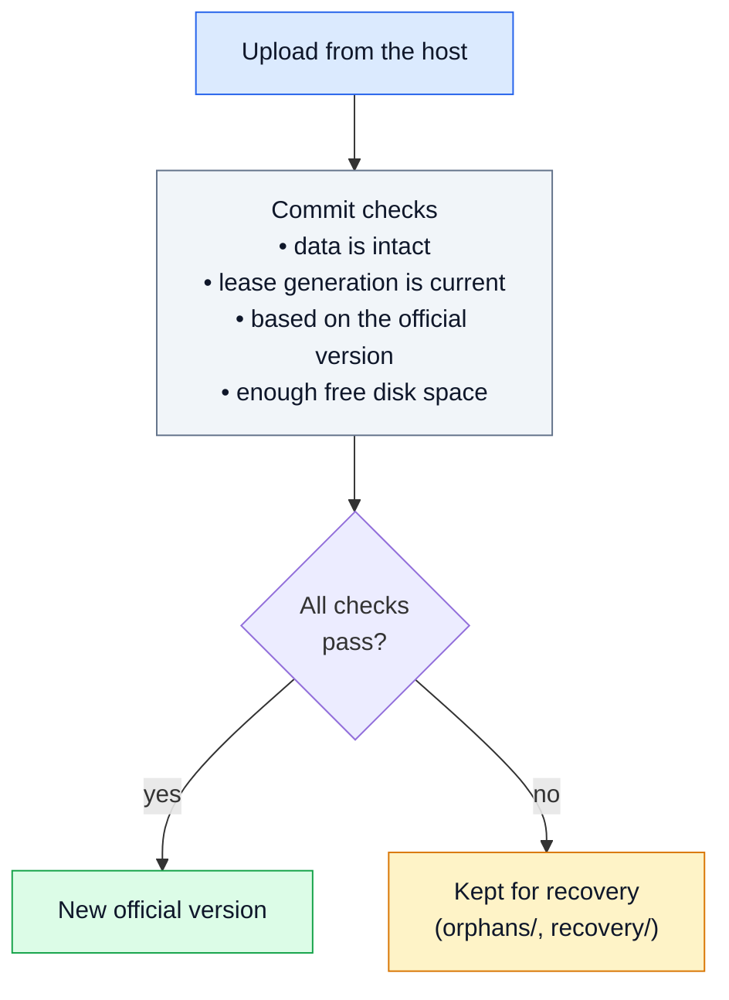
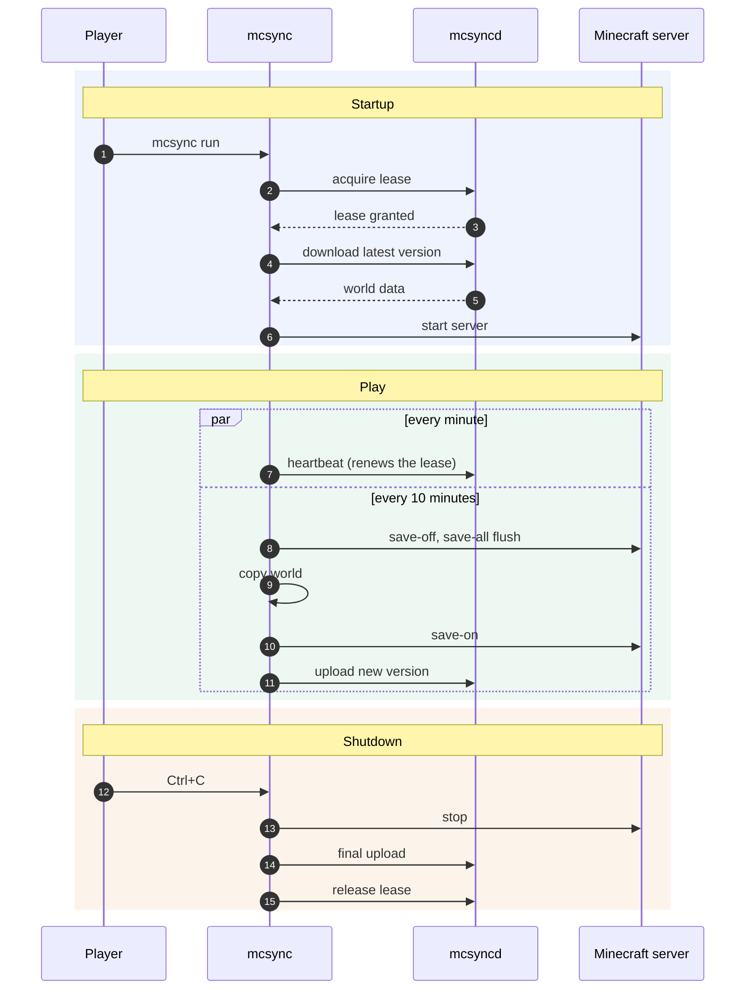
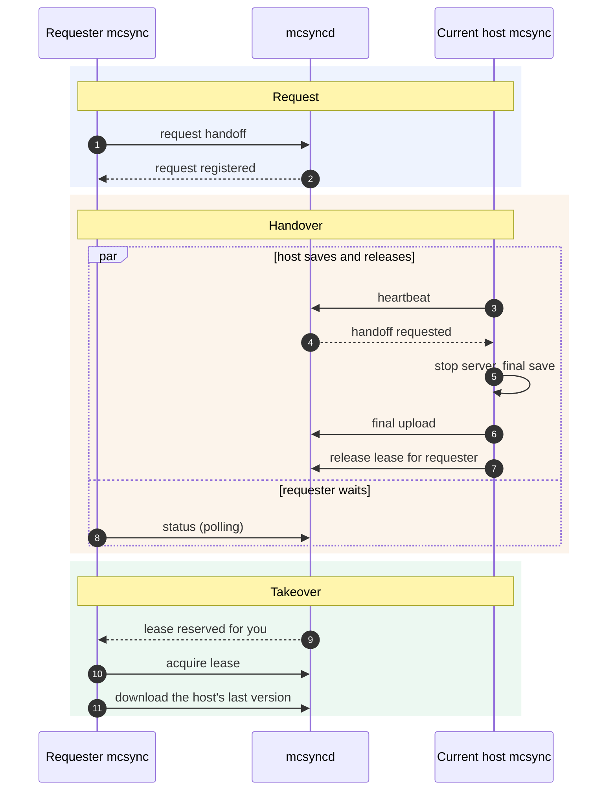
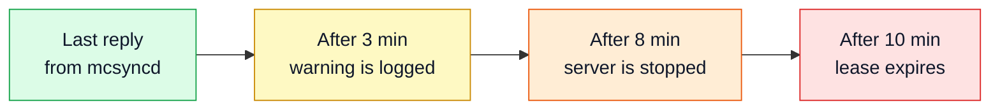

# Architecture

[Back to README](../README.md)

## Overview

mcsync is made of two programs.

| Program | Runs on | Role |
| --- | --- | --- |
| `mcsyncd` | The always-on machine | HTTP API, lease and version tracking, restic archive, device management |
| `mcsync` | Each player's PC | Starts and controls the Minecraft server, saves the world periodically, releases the lease on exit |

The agent sends commands to the Minecraft server through its standard input and reads its console output for readiness and save confirmations. RCON is not used. The always-on machine never runs Minecraft.

## The lease

At most one player is the **host** at any time. Being host means holding the lease.

- The lease lasts 10 minutes and is renewed by a heartbeat every minute.
- Only the clock of the always-on machine counts; the clocks of the players' PCs are never compared.
- Every new lease increments a **generation** number. Saves are tagged with the generation they were made under, so a save from an old host can never be mistaken for a current one.
- Identity always comes from the device token, never from the contents of a request.

## Versions and commits

Every save is uploaded to the always-on machine and becomes a new version in a restic repository. A version becomes the **official** version only if all of the following hold:

The "based on the official version" check is a compare-and-swap against the current official pointer. Uploads that fail a check are never lost: they are stored and can be recovered manually.

The archive is a restic repository encrypted with a key generated by `mcsyncd init`. Log files, crash reports, the cache and `session.lock` are excluded.

## A play session

The Minecraft server is never killed on `Ctrl+C`. The agent stops it with the `stop` command and only terminates it if it does not respond.

If the local copy of the world is already the latest official version, nothing is downloaded at startup. A copy left unconfirmed by an abrupt shutdown is reconciled on the next start and, if needed, preserved under `recovery`.

## Host handoff

When someone else is already hosting, `mcsync handoff` asks them to pass the lease on. Only one request can be pending at a time. The lease is reserved for the requester for 3 minutes, so nobody else can take it in between.

Details:

- The server reserves the lease only if the release names the requester of the pending request. Otherwise the release still succeeds but the lease is left free, so the host is never stuck with a stopped game and a held lease.
- Before releasing, the host checks the request again: if it was withdrawn while saving, it releases with no reservation; if a different request arrived, it releases to the new requester.
- If the requester gives up (timeout or `Ctrl+C`), the request is withdrawn, together with the reservation if the host had already released. If the host had not released yet, it carries on playing.
- Players connected to the old host are not moved automatically; they reconnect to the new host.

## When the always-on machine is unreachable

The host does not keep playing on a world that would not be saved.

The world on the host's PC is left untouched and is uploaded on the next session. If the final save fails, `mcsync` says so explicitly and keeps the local copy.

## Default timings

| What | Default | Option |
| --- | --- | --- |
| Lease duration | 10 minutes | none |
| Heartbeat | 1 minute | `--heartbeat-every` |
| Save to the always-on machine | 10 minutes | `--upload-every` |
| Warning without the always-on machine | 3 minutes | none |
| Server stop without the always-on machine | 8 minutes | none |
| Lease reservation after a handoff | 3 minutes | none |
| Wait for a handoff | 5 minutes | `--handoff-timeout` |
| Handoff polling | 3 seconds | `--handoff-poll` |
| Invite validity | 24 hours | none |
| Free disk space kept on the always-on machine | 20 GB | `--reserve-gb` |
